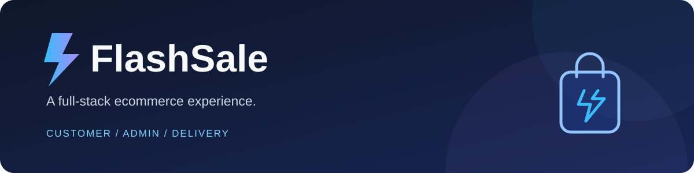

<p align="center">
  
</p>

<p align="center">
  A React storefront powered by Django REST Framework, PostgreSQL, and Redis.<br />
  Shopping, payments, order management, and delivery — in one project.
</p>

<p align="center">
  <a href="#tech-stack">Tech Stack</a> ·
  <a href="#features">Features</a> ·
  <a href="#getting-started">Getting Started</a> ·
  <a href="#verification">Verification</a> ·
  <a href="#roadmap">Roadmap</a>
</p>

<p align="center">
  
  
</p>

## Overview

**FlashSale** is a full-stack ecommerce project with separate customer, administrator, and delivery-partner workflows. Customers can browse products, manage their carts, pay through Razorpay, and view orders. Administrators manage delivery assignments and partner approvals, while delivery partners update assigned orders.

The project includes JWT authentication, server-side payment verification, PostgreSQL transaction locking, and Redis catalog caching. It is currently a portfolio/demo project; production limitations are documented below.

## Tech Stack

<p align="center">
  <a href="https://skillicons.dev">
    
  </a>
</p>

<p align="center">
  
  
  
</p>

| Layer | Technologies | Purpose |
|---|---|---|
| Frontend | HTML, CSS, JavaScript, React | Storefront, dashboards, and interactive UI |
| UI & tooling | Bootstrap, Vite, React Router | Styling, build tooling, and navigation |
| API client & charts | Axios, Chart.js | API requests and dashboard charts |
| Backend | Python, Django, Django REST Framework | Models, APIs, validation, and permissions |
| Authentication | Simple JWT | Access and refresh tokens |
| Database | PostgreSQL | Persistent data and transaction locking |
| Cache | Redis, django-redis | Product catalog caching |
| Payments | Razorpay | Test checkout and server-side verification |
| Verification | Django tests, Playwright, Docker | Regression tests, browser checks, and local Redis |

<p align="center">
  
</p>

## Features

### Customer storefront

- Product browsing, keyword search, category filters, and client-side pagination.
- Cart addition, quantity adjustments, removal, and total calculation.
- Shipping address entry and optional location detection.
- Razorpay Test Mode checkout with payment success/failure feedback.
- Customer profile and order history with delivery status.

### Administrator & delivery portals

- Separate customer, administrator, and delivery login portals.
- Administrator order overview, delivery assignment, and partner approval workflow.
- Delivery dashboard for assigned orders and delivery progress.
- Backend permission checks and controlled delivery status transitions.

### Security & order handling

- Public registration is restricted to customer and delivery roles.
- Credentials are supplied through environment variables.
- Checkout snapshots store customer, address, quantity, and purchase price.
- Verification checks payment signature, ownership, amount, currency, and captured status.
- Duplicate payment callbacks do not create duplicate orders.
- Fulfillment updates orders and stock atomically using PostgreSQL row locks.
- Successful fulfillment invalidates the cached catalog.

## Architecture

```text
React storefront
      │ REST API + JWT
      ▼
Django REST Framework ────── Razorpay Test Mode
      │                            │
      │                    Payment verification
      ├── PostgreSQL               │
      │   Users, carts, payments, orders, stock
      └── Redis
          Product catalog cache
```

## Getting Started

### 1. Clone the project

```bash
git clone https://github.com/Shazil81/flash-sale-ecommerce.git
cd flash-sale-ecommerce
```

### 2. Start the backend

Python and Node.js/npm are required. The commands below use PowerShell and SQLite for a quick local setup. PostgreSQL and Redis configuration is covered in the [setup guide](docs/SETUP.md).

```powershell
cd ecommerce-backend
python -m venv venv
.\venv\Scripts\python.exe -m pip install -r requirements.txt
$env:DJANGO_DEBUG = 'true'
$env:DB_ENGINE = 'sqlite'
.\venv\Scripts\python.exe manage.py migrate
.\venv\Scripts\python.exe manage.py runserver
```

To load sample catalog data, run `python seed_data.py` with the same interpreter/environment. It fetches public sample products from DummyJSON.

### 3. Start the frontend

Open a second terminal from the project root:

```bash
cd ecommerce-frontend
npm ci
npm run dev
```

Open **http://localhost:5173**. The default API URL is `http://127.0.0.1:8000/api`; override it with `VITE_API_URL` when needed.

### Configuration

See [the environment variable reference](ecommerce-backend/.env.example) and [full setup/deployment instructions](docs/SETUP.md).
For Render, follow [the backend deployment guide](docs/RENDER.md), including the correct `core.wsgi:application` start command.

- `.env.example` is a reference; Django does **not** automatically load `.env` files.
- Payments need your own Razorpay **test** credentials and automatic capture configuration.
- PostgreSQL uses `DB_NAME`, `DB_USER`, `DB_PASSWORD`, `DB_HOST`, and `DB_PORT`.
- Set `REDIS_URL` to enable shared Redis caching; local memory is the fallback.
- Administrator roles must be assigned through a trusted management process.

## Verification

These are recorded local results, not a continuously updated CI status badge.

| Check | Result |
|---|---|
| Backend regression + PostgreSQL/Redis integration tests | **15 passed** |
| Concurrent purchases | 12 buyers / 5 units, repeated 5 times; no overselling in tested cases |
| Concurrent duplicate payment callbacks | 8 callbacks → 1 order |
| Real Redis | Expiry, cache hits without SQL queries, and checkout invalidation passed |
| Frontend | ESLint and production build passed |
| Browser + actual Razorpay Test Mode | Registration, login, cart quantities, netbanking success, and netbanking failure verified |
| Checkout cancellation | Remains unresolved in browser verification |

Automated backend tests mock Razorpay while using real PostgreSQL/Redis for integration tests. The separate browser test used Razorpay's actual Test Mode service. Successful card and UPI payments have not been verified.

Run the basic backend checks:

```powershell
cd ecommerce-backend
$env:DJANGO_DEBUG = 'true'
.\venv\Scripts\python.exe manage.py test store --settings=core.test_settings
```

PostgreSQL/Redis test prerequisites and commands are in the [setup guide](docs/SETUP.md). The [verification report](VERIFICATION.md) records the exercised cases and limitations.

## Project Structure

```text
flash-sale-ecommerce/
├── ecommerce-frontend/     # React UI, pages, authentication, and API client
├── ecommerce-backend/
│   ├── core/               # Django settings and project URLs
│   └── store/              # Models, serializers, APIs, migrations, and tests
├── docs/                   # Setup guide and README artwork
├── README.md
└── VERIFICATION.md
```

## Roadmap

- [ ] Resolve and verify checkout cancellation.
- [ ] Reserve stock before payment and expire abandoned checkouts.
- [ ] Add payment webhooks, reconciliation, and automated refunds.
- [ ] Group multiple order items into one customer-facing order.
- [ ] Add server-side pagination, saved addresses, and password reset.
- [ ] Add deployment automation and continuous integration.

**Production note:** stock is checked after payment capture. If another purchase consumes the stock, fulfillment returns a support/refund-required response. Automated refunds are not implemented. Configure HTTPS, secure environment values, explicit hosts/origins, and production services before deployment.

## Author

Built by **[Shazil81](https://github.com/Shazil81)**.

Technology icons are provided by [Skill Icons](https://github.com/tandpfun/skill-icons); badges are provided by [Shields.io](https://shields.io).
